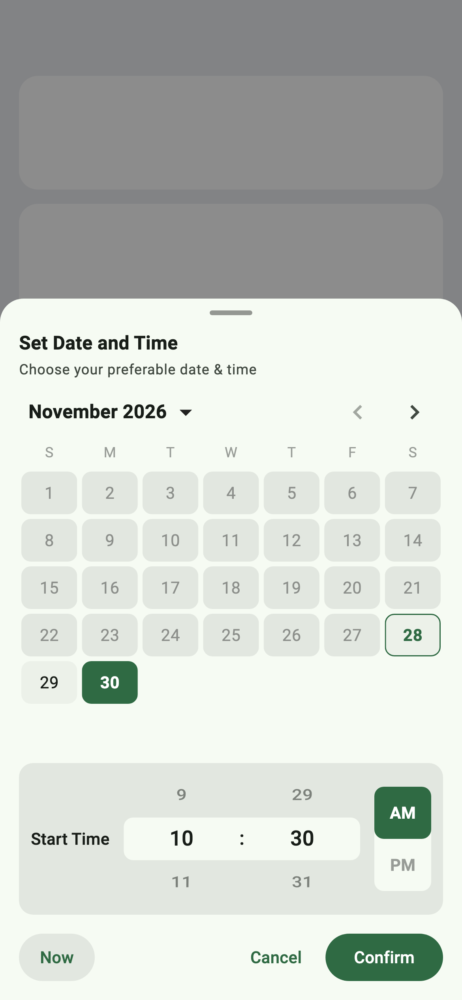
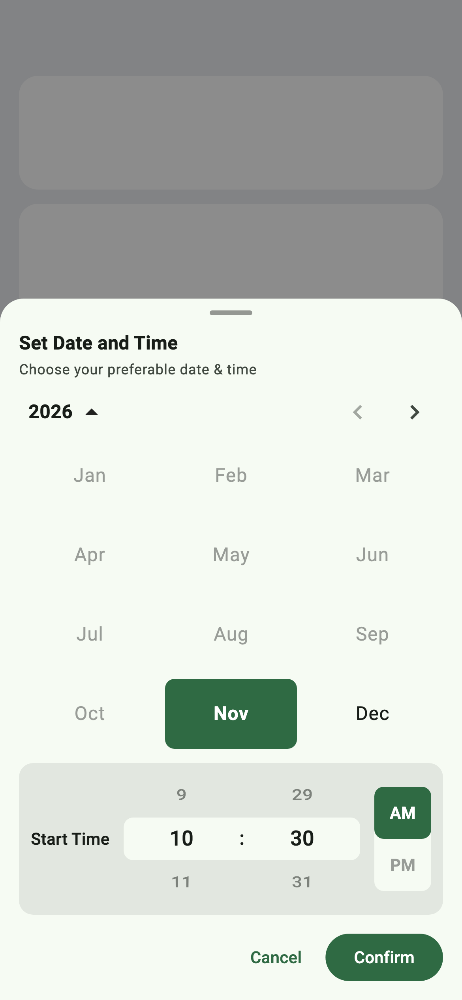
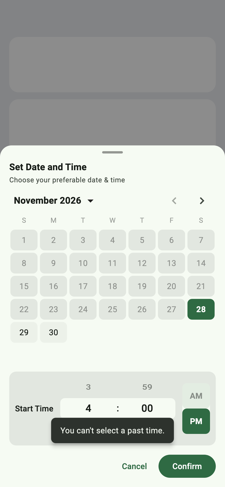
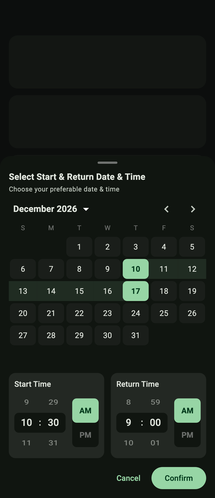
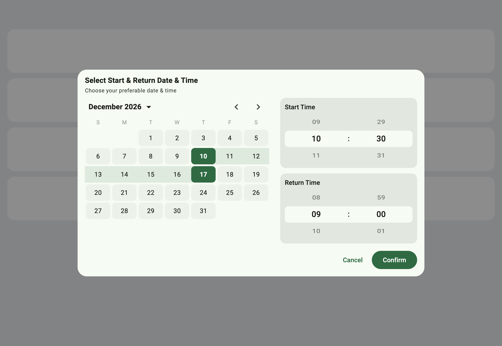

# date_time_picker_sheet

A date and time picker for Flutter that opens as a **bottom sheet** on phones and a **dialog** on wide screens. It has
a calendar with day, month and year views, scroll-wheel time input, and single or range selection. It's built only on
Flutter and `intl`, so it needs no other dependencies and no native code.

| Bottom sheet | Month view | Refused time |
|:---:|:---:|:---:|
|  |  |  |

| Range, dark theme |
|:---:|
|  |



## Features

- **Two presentations.** `showDateTimePicker` opens a bottom sheet, a dialog, or picks one by screen width.
- **A calendar you can jump around.** Tap the title to open the month view, tap again for the year view. Arrows and
  swipes stop at your date limits.
- **Scroll-wheel times** that work with touch, mouse drag, mouse wheel, trackpad and arrow keys. 12-hour or 24-hour,
  with any minute step that divides 60.
- **Single or range.** A range paints a continuous band between the start and end day, previews it under the mouse, and
  asks for a start and an end time.
- **Rules built in.** Date limits, "start now" ranges, "today only", and past times blocked by default or allowed.
- **Clear feedback.** A refused time keeps the old one and explains why in a snackbar inside the picker.
- **Your own checks.** An optional async `validator` can reject a pick with a message, for example a booking that is
  already taken, while the confirm button shows a loader.
- **Themeable.** Colors come from your app theme. Set `primaryColor` for one picker, or add a theme extension app-wide.
- **Localizable.** Every visible string is a label you can translate. Month and weekday names follow your app's locale.
- **Accessible.** Right-to-left, dark theme and large text are supported. Day cells announce their full date, and the
  wheels can be adjusted by screen readers and arrow keys.

## Install

```yaml
dependencies:
  date_time_picker_sheet: ^0.1.0
```

The package needs Flutter 3.27 or newer.

## Quick start

```dart
import 'package:date_time_picker_sheet/date_time_picker_sheet.dart';

final DateTimePickerResult? result = await showDateTimePicker(context);

if (result != null) {
  print(result.start); // the picked date and time
}
```

`showDateTimePicker` returns `null` when the user dismisses the picker. By default it opens a bottom sheet on screens
narrower than 600 logical pixels and a dialog on wider ones. Force one with `presentation`:

```dart
showDateTimePicker(context, presentation: DateTimePickerPresentation.dialog); // or .sheet, .auto
```

## Recipes

**A start and an end**

```dart
final DateTimePickerResult? trip = await showDateTimePicker(
  context,
  config: DateTimePickerConfig(
    mode: DateTimePickerMode.range,
    initialStart: savedStart,
    initialEnd: savedEnd,
    minuteInterval: 5,
  ),
);
// trip.start and trip.end
```

**A trip that starts now.** The start is fixed to the current moment and only the end is picked:

```dart
DateTimePickerConfig(mode: DateTimePickerMode.range, startNowOnly: true)
```

**A "Now" button** in single mode. The result has `isNow` set:

```dart
DateTimePickerConfig(showNowAction: true)
```

**Limits.** Only the next 30 days, and nothing before tomorrow:

```dart
DateTimePickerConfig(
  firstDate: DateTime.now().add(const Duration(days: 1)),
  lastDate: DateTime.now().add(const Duration(days: 30)),
)
```

**Allow past dates**, for example a birthday or a report date. The picker still opens on the current time:

```dart
DateTimePickerConfig(allowPast: true)
```

**Reject a pick with your own check.** Return a message to keep the picker open, or `null` to accept:

```dart
DateTimePickerConfig(
  validator: (DateTimePickerResult picked) async {
    final bool free = await api.isAvailable(picked.start);
    return free ? null : 'That time is already booked';
  },
)
```

## Configuration

Everything is set on `DateTimePickerConfig`. All fields are optional.

| Field | Default | What it does |
|---|---|---|
| `mode` | `single` | `single` picks one moment. `range` picks a start and an end. |
| `initialStart` | next free slot | Where the calendar and the start time open. A value before the earliest allowed start falls back to the default. |
| `initialEnd` | start + 1 hour | Where the end opens, in range mode. |
| `firstDate` | now | The earliest allowed start. When set, it takes priority over `allowPast`. |
| `lastDate` | 31 Dec, 5 years ahead | The latest selectable day. Only the date counts. |
| `allowPast` | `false` | Allows days and times before now, up to 100 years back. Can't be combined with `startNowOnly`. |
| `startNowOnly` | `false` | Range only. Fixes the start to now. |
| `todayOnly` | `false` | Only today can be selected. |
| `use24HourFormat` | device setting | Forces 24-hour or 12-hour wheels. |
| `minuteInterval` | `1` | The minute step. It must divide 60. |
| `showNowAction` | `false` | Single only. Adds a "Now" button. |
| `validator` | none | An async check that can reject a pick with a message. |
| `labels` | English | Every visible string. |
| `primaryColor` | theme | The selection color for this picker only. |

`DateTimePickerResult` holds `start`, `end` (range mode only) and `isNow`.

## Translations

Pass your own text with `DateTimePickerLabels`. AM and PM default to your app's `MaterialLocalizations`, and month and
weekday names follow its locale.

```dart
DateTimePickerConfig(
  labels: DateTimePickerLabels(
    title: l10n.pickDateAndTime,
    confirm: l10n.confirm,
    cancel: l10n.cancel,
    startInPast: l10n.pastTimeNotAllowed,
  ),
)
```

The two messages shown when a time is refused are `startInPast` ("You can't select a past time.") and
`endNotAfterStart` ("Return time must be after the start time."). They also appear if a time slips into the past by
the moment the user presses Confirm.

## Colors and shape

The picker takes its colors from your theme: `colorScheme.primary` for the selection and `cardColor` for the surface.

For a single picker, pass `primaryColor`. Text on it turns white or black by brightness:

```dart
DateTimePickerConfig(primaryColor: const Color(0xFF039D55))
```

To restyle the picker app-wide, add the theme extension. Anything you leave out falls back to your color scheme:

```dart
ThemeData(
  extensions: const [
    DateTimePickerThemeData(
      selectedColor: Color(0xFF039D55),
      onSelectedColor: Colors.white,
      cellRadius: 10,
      containerRadius: 24,
    ),
  ],
)
```

`DateTimePickerThemeData` also takes `surfaceColor`, `rangeColor` and `sectionColor`. The snackbar follows your
`SnackBarThemeData`.

## Your own route

`showDateTimePicker` covers most cases. If you navigate with another package, show the frames yourself. They pop with
the result:

```dart
final DateTimePickerResult? result = await showModalBottomSheet<DateTimePickerResult>(
  context: context,
  isScrollControlled: true,
  backgroundColor: Colors.transparent,
  builder: (_) => const DateTimePickerSheet(config: DateTimePickerConfig()),
);

final DateTimePickerResult? inDialog = await showDialog<DateTimePickerResult>(
  context: context,
  builder: (_) => const DateTimePickerDialog(),
);
```

To put the picker in a page without a sheet or dialog around it, use `DateTimePicker(config:, onSubmitted:,
onCancelled:)`. It never closes itself; it calls your callbacks.

## How it behaves

- Times before the earliest allowed slot are greyed out. If a wheel lands on one, or the user taps a greyed AM, the
  picker keeps the previous time, rolls the wheel back, and shows a snackbar.
- Every message appears as a snackbar drawn inside the picker, because a regular `ScaffoldMessenger` snackbar would be
  hidden behind the sheet or dialog. It hides after 3 seconds, or as soon as the selection changes.
- A range that opens on a single day waits for its end date: the first tap on a later day becomes the end and the start
  stays. After that, a tap starts a new range and the next tap ends it.
- Moving the start later pushes a same-day end so it stays at least one minute step after the start.
- Confirm is disabled while a wheel is still moving, so a half-finished scroll is never submitted.

## Example

The [`example`](example) app is a gallery with switches for every option above, including dark theme and right to left:

```bash
cd example
flutter run -d chrome
```

## Development

```bash
flutter analyze
flutter test                                          # unit, widget and golden tests
flutter test --update-goldens test/golden_test.dart   # after an intended visual change
flutter test tool/generate_screenshots_test.dart      # regenerate screenshots/ with real fonts
```

## License

MIT. See [LICENSE](LICENSE).
